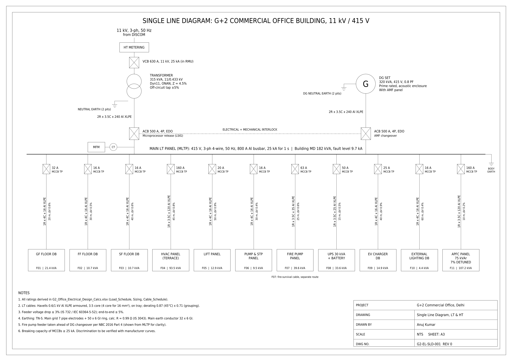

# Electrical Design of a G+2 Commercial Office Building

Complete LT/HT electrical design for a 1,800 m² (G+2) commercial office in Delhi: load estimation, equipment sizing, single line diagram, cable schedule, lighting and earthing. Built as a self-directed project to practise building-services (MEP) electrical design.

## Design summary

| Item | Result |
|---|---|
| Building | Ground + 2 floors, 600 m² per floor, commercial office, Delhi |
| Connected load | 272 kW |
| Maximum demand (diversity 0.9) | 163 kW / 182 kVA, PF 0.89 |
| Transformer | 315 kVA, 11/0.433 kV, Dyn11, Z = 4.5% |
| LV full-load current / fault level | 438 A / 9.7 kA (MLTP rated 25 kA, 1 s) |
| DG set | 320 kVA with AMF panel (50% HVAC on DG, fire pump fully backed) |
| UPS | 30 kVA online, 32 × 12 V 65 Ah VRLA, 30 min backup |
| APFC | 75 kVAr, 7% detuned (target PF 0.98) |
| Incomers | ACB 500 A, 2R × 3.5C × 240 mm² Al XLPE |
| Feeders | 13 feeders, all within 3% voltage drop |
| Earthing (IS 3043) | 7 pipe electrodes + 60 m GI ring → 0.99 Ω; main conductor 32 × 6 mm GI |
| Lighting | Lumen method, 300 lux in offices, LPD 4.6 W/m² (ECBC 2017 limit 9.5) |

## Repository contents

| Folder / file | What it is |
|---|---|
| `calcs/G2_Office_Electrical_Design_Calcs.xlsx` | Calculation workbook with live formulas. Change any input and everything updates |
| `drawings/G2-EL-SLD-001.pdf` | Single line diagram, A3 |
| `drawings/G2-EL-SLD-001.dxf` | Same SLD, editable in AutoCAD |
| `drawings/G2-EL-SLD-001.png` | Preview image |

### Workbook sheets

1. **Inputs**: supply data, margins, loading limits, derating factors, soil data
2. **Lighting**: room index, utilisation factor, fixture count, achieved lux, LPD check
3. **Load_Schedule**: 29 loads with demand factors, kW/kVAr/kVA, DG and UPS tagging, feeder allocation
4. **Sizing**: transformer, DG (incl. fire-pump starting check), UPS and battery, APFC
5. **Cable_Schedule**: breaker selection, derating, size by ampacity and by voltage drop, final selection
6. **Earthing**: electrode resistance, parallel electrodes (IS 3043 λ factors), strip electrode, conductor sizing
7. **Ref_Tables**: Havells cable data, UF table, standard equipment ratings

## Method

- **Maximum demand:** MD = Σ(connected load × demand factor) × diversity; kVA = √(kW² + kVAr²)
- **Transformer / DG:** MD kVA × (1 + 20% future margin) ÷ 80% loading → next standard rating
- **Cables:** breaker In ≥ Ib; derated Iz ≥ In; ΔV% = (mV/A/m × I × L) ÷ (1000 × V) ≤ 3%; final size = larger of the two
- **Earthing:** R = ρ/(2πL)·ln(4L/d); Rn = R1(1 + λα)/n; grid = electrodes ∥ ring strip; S = I√t/k
- **Lighting:** N = (E × A) ÷ (Φ × UF × MF)

## Standards and data sources

- IS 732:2019, IS 3043:2018, IS 1180, IEC 60364-5-52, IEC 60502-1
- NBC 2016 Part 8 (lighting and electrical), NBC 2016 Part 4 (fire), ECBC 2017
- Cable ampacity, resistance and rating factors: Havells International Cables catalogue (Tables 16 and 20)
- Soil resistivity 50 Ω·m: assumed, within the 10–130 Ω·m range reported for West Delhi (2014 resistivity survey)

## Limitations

- Cable reactance is a typical value (not listed in the catalogue)
- Soil resistivity must be confirmed by a site Wenner 4-point test
- Still to verify with manufacturer data: breaker discrimination, cable short-circuit withstand, and DG transient response (ISO 8528-5)

## Author

**Anuj Kumar**, B.Tech Electrical Engineering, Delhi Technological University (2027)
